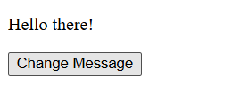
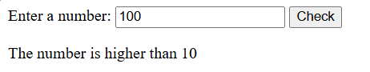
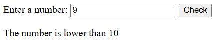
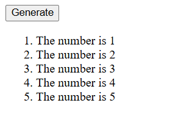

# BIC21203 Lab 4a – Client-Side Scripting (JavaScript)

## Student Information

- **Name:** MUHAMMAD MUQRY HAQIMY BIN MOHD AZLI
- **Student ID:** CI250118
- **Course:** BIC21203 – Web Development
- **Lab:** Lab 4a – Client-Side Scripting (JavaScript)

## Introduction

This repository contains my solutions for Lab 4a of BIC21203 Web Development. This lab focuses on client-side scripting using JavaScript to develop interactive web pages.

The lab covers JavaScript functions, event handling, conditional statements, loops, and DOM manipulation.

## Lab Objectives

- Understand and implement JavaScript functions.
- Use event listeners to handle user interactions.
- Apply conditional statements to validate user input.
- Use for loops to generate dynamic HTML elements.
- Manipulate webpage content using JavaScript DOM methods.

## Project Structure

```text
bic21203-lab4a-javascript/
│
├── Q1/
│   ├── index.html
│   ├── script.js
│   └── screenshot.png
│
├── Q2/
│   ├── index.html
│   ├── script.js
│   └── screenshot.png
│
├── Q3/
│   ├── index.html
│   ├── script.js
│   └── screenshot.png
│
└── README.md
```

## Lab Questions

### Question 1 – Interactive Text Changer

**Description:**

Create an interactive webpage that changes a paragraph's text when the user clicks a button.

**JavaScript Concepts:**
- DOM Selection
- JavaScript Functions
- Event Listeners (`addEventListener`)
- `textContent` property

**Expected Output:**

Initially, the webpage displays:

`Welcome to my website!`

After clicking the **Change Message** button, the paragraph changes to:

`Hello there!`

**How to Run:**
1. Open the `Q1` folder.
2. Open `index.html` in a web browser.
3. Click the **Change Message** button.
4. Observe the updated paragraph.

**Screenshot:**




---

### Question 2 – Smart Number Validator

**Description:**

Create an interactive webpage that accepts a number from the user and displays a validation message based on the entered value.

**JavaScript Concepts:**
- Functions
- If...else if...else statements
- Input Validation
- Number Conversion
- Event Listeners
- `textContent` property

**Expected Output:**

The webpage displays different messages depending on the input:

| Input | Expected Message |
|---|---|
| 5 | The number is lower than 10 |
| 10 | The number is equal to 10 |
| 15 | The number is higher than 10 |
| abc | Please enter a valid number! |
| Empty | Please enter a valid number! |

**How to Run:**
1. Open the `Q2` folder.
2. Open `index.html` in a web browser.
3. Enter a number in the input field.
4. Click the **Check** button.
5. Observe the validation message.

**Screenshot:**




---

### Question 3 – Dynamic Number Generator

**Description:**

Create a webpage that generates an ordered list of numbers from 1 to 5 when the user clicks the Generate button.

**JavaScript Concepts:**
- JavaScript Functions
- For Loops
- DOM Manipulation
- `document.createElement()`
- `appendChild()`
- `textContent`

**Expected Output:**

When the user clicks the **Generate** button, the webpage displays:

1. The number is 1
2. The number is 2
3. The number is 3
4. The number is 4
5. The number is 5

The existing list is cleared before generating new items to prevent duplicate output.

**How to Run:**
1. Open the `Q3` folder.
2. Open `index.html` in a web browser.
3. Click the **Generate** button.
4. Observe the generated numbered list.

**Screenshot:**




---

## Technologies Used

- HTML5
- JavaScript
- Visual Studio Code
- GitHub
- Web Browser (Google Chrome / Microsoft Edge)

## Conclusion

Through this lab, I gained practical experience in using JavaScript to create interactive web pages. I learned how to use functions and event listeners to respond to user actions, apply conditional statements for input validation, and use loops with DOM manipulation to generate HTML elements dynamically. Overall, this lab improved my understanding of client-side scripting and basic web development.

---

**Course:** BIC21203 Web Development  
**Lab:** 4a – Client-Side Scripting (JavaScript)